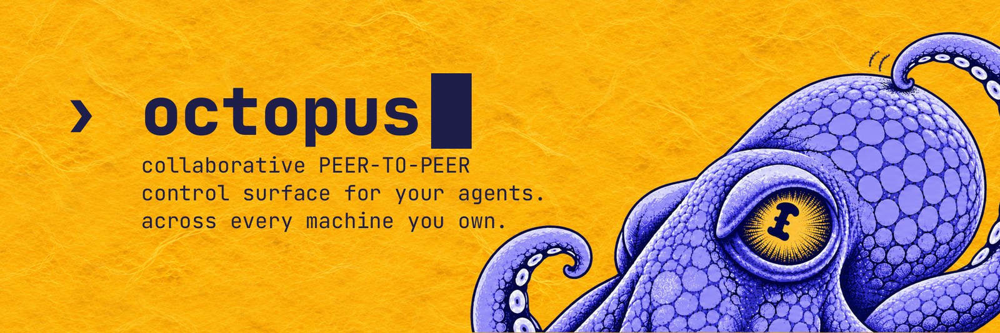
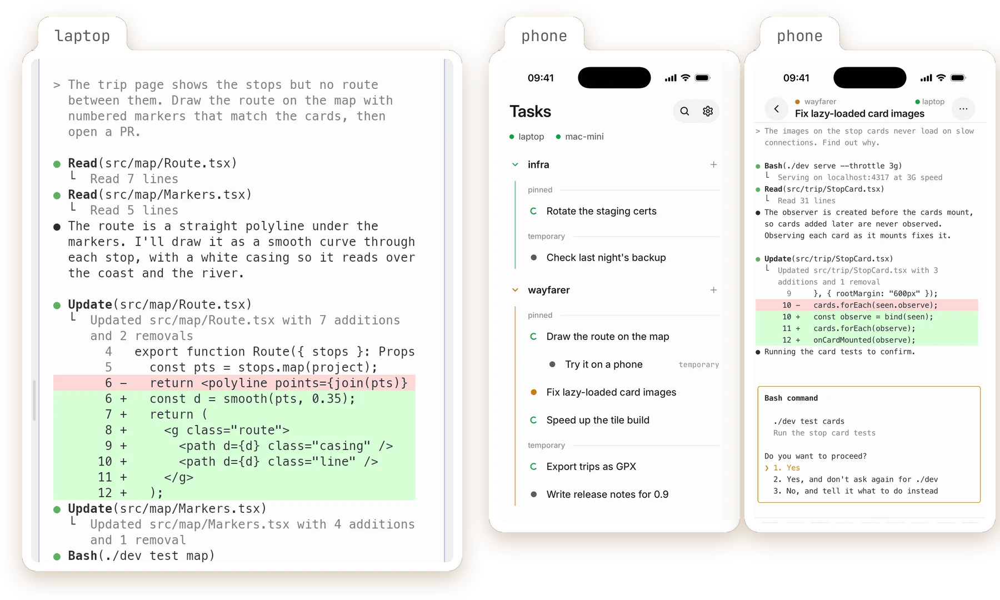
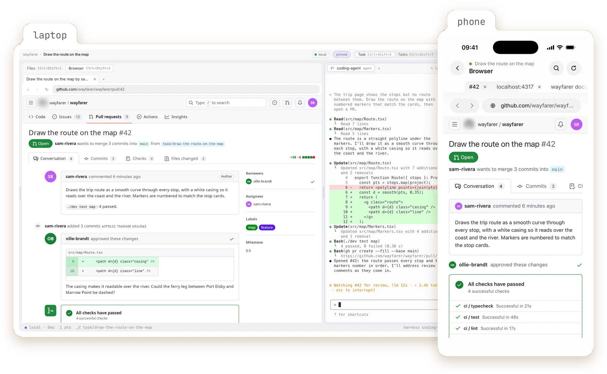
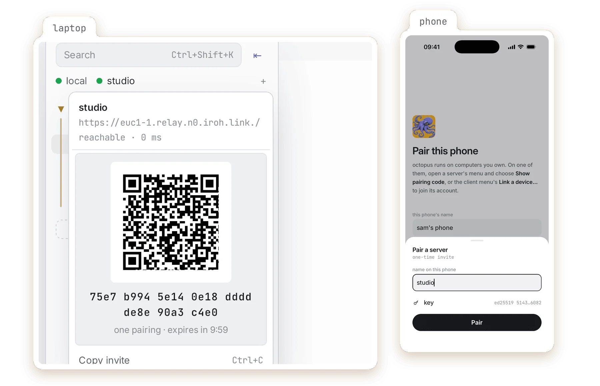

<p align="center">
  <a href="#quick-start">Quick start</a>
  ·
  <a href="docs/CONTRIBUTING.md">Contributing</a>
  ·
  <a href="docs/support.md">Support</a>
  ·
  <a href="docs/privacy.md">Privacy</a>
</p>

### One terminal, many screens

Open the same task on your laptop and your phone. A visible lock shows which device types into the terminal, and any other takes over with one tap.


### Agents in parallel

Every task runs its own Claude Code agent in its own terminal. Tasks nest into subtasks and group by workspace, and a glance at the sidebar or the Tasks board shows which agents are working and which wait on you.



### Files, browser and terminals in one window

Each task has an editor, a browser and terminal panels beside its agent.



### Pair a server, share it

Pair a device by scanning a server's QR code or pasting its invite. Hand the same invite to a teammate and their account gets in, every device of theirs with it. The server's menu lists each account, and any of them can be revoked.



### And

- **Any folder, three ways.** A task works in any folder on its server: in place, in a git worktree of its own, or in a worktree that also clones your ignored files such as `.env` and `node_modules` (on a file system that clones files, like APFS).
- **A phone app for iOS and Android.** Pair it with your servers by scanning a QR code, then check on agents and answer them from anywhere.
- **Your machines.** Tasks run on your laptop, and on any Mac mini or Linux box you install the server on. Other devices reach them through an iroh relay that forwards packets it cannot read: n0's public one or your own.

## Download

The [Releases page](https://github.com/zabealbe/octopus/releases) has the app for macOS (universal `.dmg`) and Linux (x64 and arm64 `.AppImage` and `.deb`), the Android app (`.apk`), and the headless CLI and server for macOS and Linux (`.tar.gz`).

macOS builds are ad-hoc signed until notarized builds ship, so open the app the first time with right-click → Open. On macOS 15 and later, open it once, then choose Open Anyway in System Settings → Privacy & Security.

Verify a download against the build that made it, and against the release's checksums:

```sh
gh attestation verify octopus_0.1.0_universal.dmg --repo zabealbe/octopus
shasum -a 256 --check --ignore-missing SHA256SUMS
```

## Quick start

Install the app, the CLI and a server on your laptop (macOS or Linux, with Rust and Bun):

```sh
bun install --cwd ui --frozen-lockfile && bun run --cwd ui build
cargo install --locked --path crates/cli
octopus app
```

On Linux, first install `libwebkit2gtk-4.1-dev libgtk-3-dev libsoup-3.0-dev libjavascriptcoregtk-4.1-dev librsvg2-dev libasound2-dev`.

The first start registers this machine's server as a login service.

On a machine without a display, like a Mac mini, clone the repository and add it as a second server:

```sh
cargo install --locked --path crates/cli --no-default-features
octopus server install --name mac-mini \
  --socket ~/.octopus/server.sock --store ~/.octopus/store.db \
  --worktrees ~/.octopus/worktrees --terminal-host ~/.octopus/host.sock \
  --udp 0.0.0.0:7300 --relay https://euc1-1.relay.n0.iroh.link./ \
  --microphone false --log ~/.octopus/server.log
octopus server add --name mac-mini --socket ~/.octopus/server.sock
octopus pairing offer --server mac-mini
```

Paste the invite into **Pair a server** (the `+` after the server names in the sidebar), or scan its QR code with the phone app. The iOS app builds from source.

Developers start at [CONTRIBUTING.md](docs/CONTRIBUTING.md).
