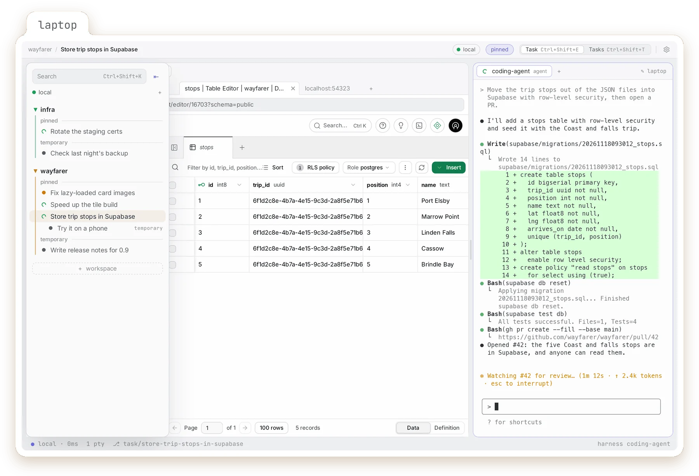
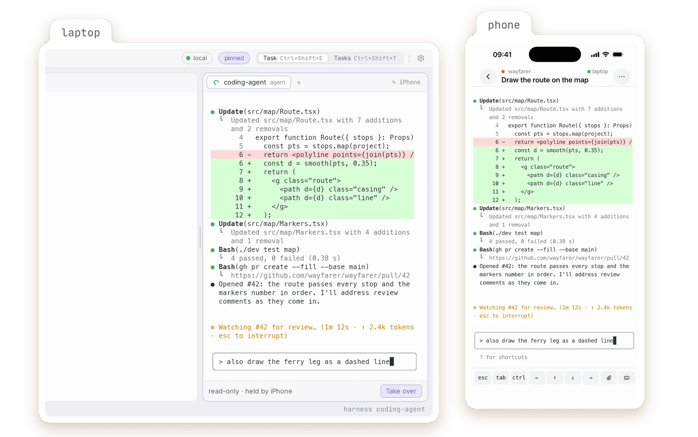

<p align="center">
  <a href="#quick-start">Quick start</a>
  ·
  <a href="docs/CONTRIBUTING.md">Contributing</a>
  ·
  <a href="docs/support.md">Support</a>
  ·
  <a href="docs/privacy.md">Privacy</a>
</p>



### One terminal, many screens

Open the same task on your laptop and your phone. A visible lock shows which device types into the terminal, and any other takes over with one tap.



### Agents in parallel

Every task runs its own Claude Code agent in its own terminal. Tasks nest into subtasks and group by workspace, and a glance at the sidebar or the Tasks board shows which agents are working and which wait on you.


### Files, browser and terminals in one window

Each task has an editor, a browser and terminal panels beside its agent.


### Pair a server, share it

Pair a device by scanning a server's QR code or pasting its invite. Hand the same invite to a teammate and their account gets in, every device of theirs with it. The server's menu lists each account, and any of them can be revoked.


### And

- **Any folder, three ways.** A task works in any folder on its server: in place, in a git worktree of its own, or in a worktree that also clones your ignored files such as `.env` and `node_modules` (on a file system that clones files, like APFS).
- **A phone app for iOS and Android.** Pair it with your servers by scanning a QR code, then check on agents and answer them from anywhere.
- **Your machines.** Tasks run on your laptop, and on any Mac mini or Linux box you install the server on. Other devices reach them through an iroh relay that forwards packets it cannot read: n0's public one or your own.

## Download

The [Releases page](https://github.com/zabealbe/octopus/releases) has the app for macOS (universal `.dmg`) and Linux (amd64 and arm64 `.AppImage`), the Android app (`.apk`), and the headless CLI and server for Linux (x86_64 and aarch64 `.tar.gz`). On a Mac, the app carries the same `octopus` command, at `octopus.app/Contents/MacOS/octopus`.

Verify a download against the build that made it, then check it against the release's `SHA256SUMS`, which sits beside it in the same folder:

```sh
gh attestation verify octopus_<version>_universal.dmg --repo zabealbe/octopus
shasum -a 256 --check --ignore-missing SHA256SUMS
```

## Quick start

Download the app from the Releases page and open it. On macOS it offers to move itself to Applications first; on Linux, mark the AppImage executable first (`chmod +x octopus_*.AppImage`).

Every start of the app checks this machine's server and repairs it: registered as a login service, running the installed binary, and answering with at least this version.

On a machine without a display, like a Linux box, unpack the headless CLI from the Releases page, install its server, and offer to pair:

```sh
tar -xzf octopus-cli_<version>_<target>.tar.gz
./octopus install
octopus pairing offer --server "$(hostname)"
```

`octopus install` copies the binary to `~/.octopus/bin/octopus`, links `~/.local/bin/octopus` to it, and registers its server with systemd. Every later run of the CLI repairs that server the way the app does, so running a newer release's `octopus` once upgrades it.

Paste the invite into **Pair a server** (the `+` after the server names in the sidebar), or scan its QR code with the phone app. The iOS app builds from source.

Developers start at [CONTRIBUTING.md](docs/CONTRIBUTING.md).
